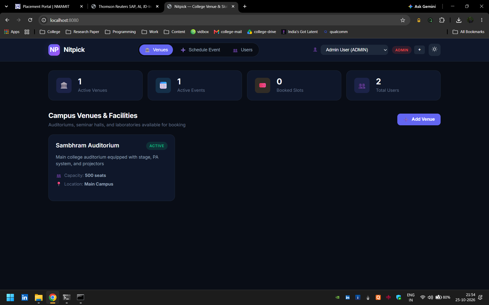
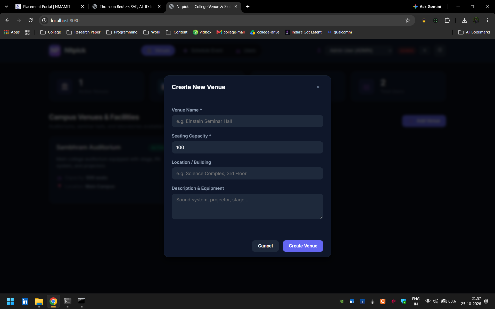
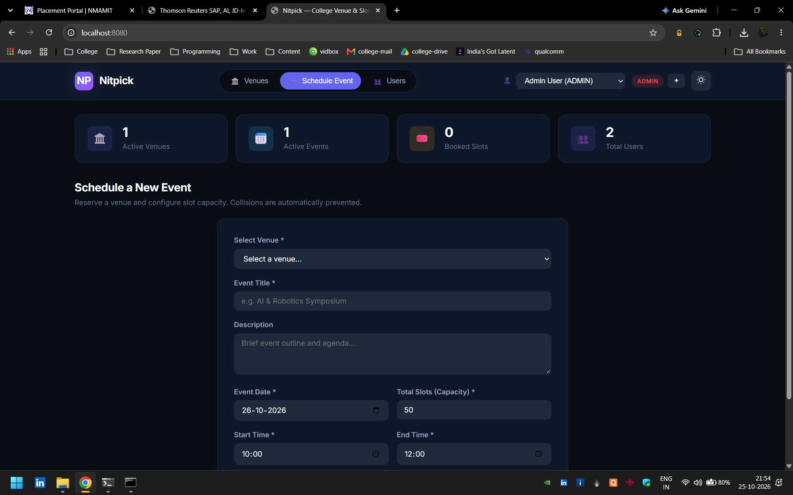
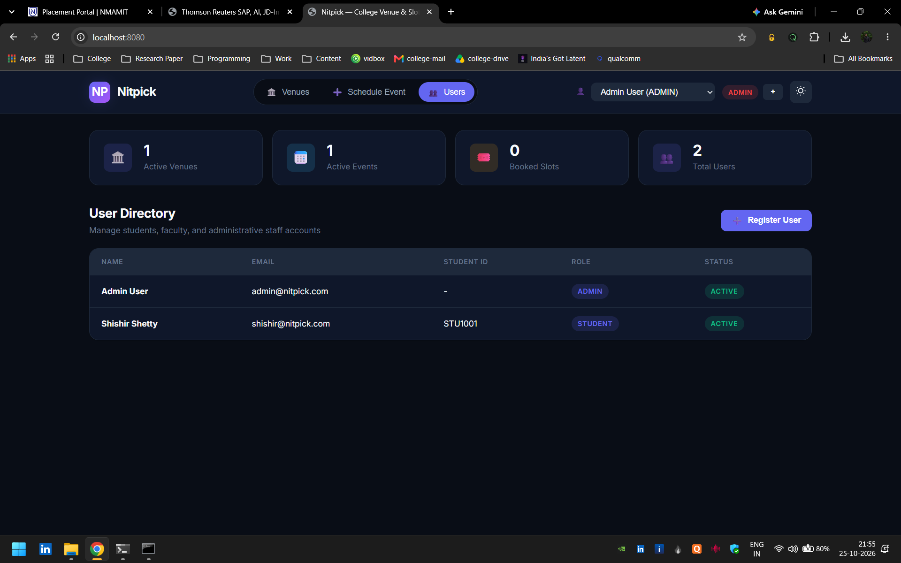
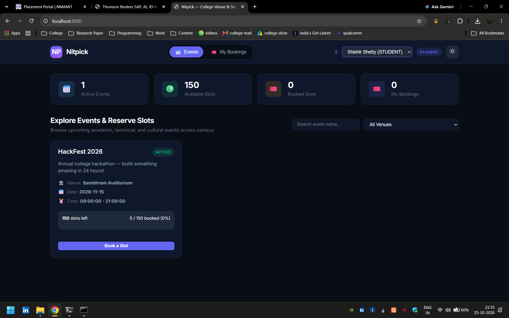
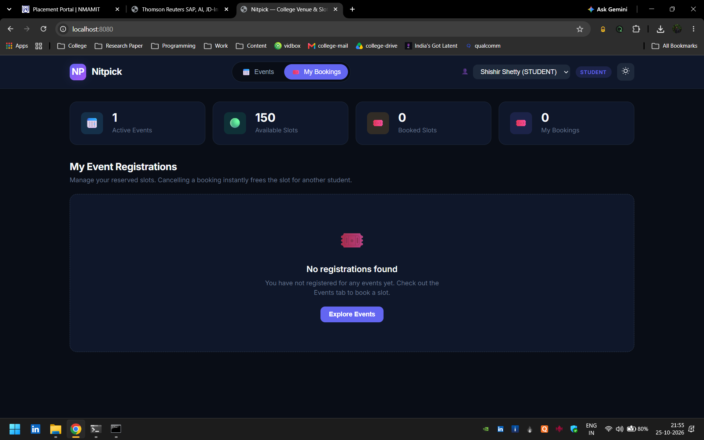
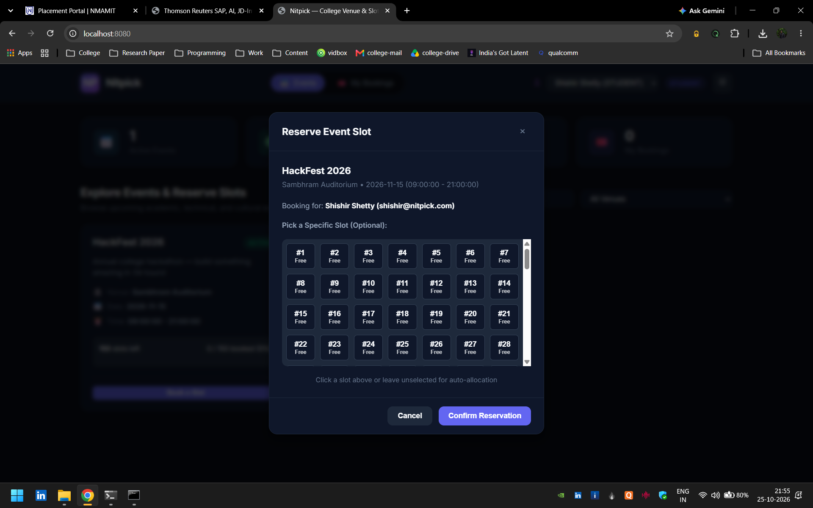

# 🏛️ Nitpick

Nitpick is a **full-stack college venue and event slot booking system** built with Spring Boot, MySQL, and a lightweight vanilla JavaScript frontend.
Admins and faculty can schedule events at campus venues without time collisions, and students can reserve seats or slots, with zero double-booking even under heavy concurrent traffic.

---

## 📸 Screenshots

|  |
|:--:|

|  |  |  |
|:--:|:--:|:--:|

|  |  |  |
|:--:|:--:|:--:|

> 🖼️ Click on any image to view it in full size.

---

## ✨ Features

* 🏫 **Campus Venue Catalog:** Track auditoriums, labs, and conference halls with capacity limits, location, description, and active status.
* 📅 **Conflict-Free Event Scheduling:** Schedule symposiums, hackathons, and workshops with automatic time-collision prevention per venue.
* 🎟️ **Seat & Slot Reservation Engine:** Book the lowest free slot automatically, or pick a specific one from an interactive visual grid.
* 🔒 **Race Condition Safety:** JPA optimistic locking (`@Version`) plus composite database constraints guarantee no overbooking.
* ♻️ **Instant Slot Reclamation:** Cancelled bookings free their slot immediately for the next registrant.
* 👥 **Role-Based UI:** Switch between `ADMIN`, `FACULTY`, and `STUDENT` with tabs and permissions that adapt to each role.
* 📊 **Live KPI Dashboard:** Active venues, active events, available slots, booked slots, and personal bookings at a glance.
* 🌗 **Dark & Light Themes:** CSS-variable theming with a saved preference and animated toast notifications.
* 🧪 **Deterministic Dev State:** Flyway clean-and-migrate resets the database to known seed data on every startup, ideal for demos and testing.

---

## 🚀 Tech Stack

* **Language:** Java 25
* **Framework:** Spring Boot 4.1.1 (Web MVC, Spring Data JPA / Hibernate, Bean Validation)
* **Database:** MySQL 8.0+ (production) and H2 in MySQL mode (tests)
* **Migrations:** Flyway (Community + MySQL)
* **Frontend:** Vanilla HTML5, CSS3 variables, and ES6 JavaScript, served as Spring static resources, with the Google Inter font
* **Build Tool:** Apache Maven (Maven Wrapper included)
* **Testing:** Spring Boot Test with MockMvc integration tests

---

## 🛠️ Setup Instructions

### Prerequisites

* JDK 25
* MySQL 8.0+ running on port `3306`
* Maven 3.9+ (or use the bundled `mvnw` / `mvnw.cmd`)

Clone the repository and get started!

```bash
# 1. Clone the repo
git clone https://github.com/programmingwithshishir/nitpick.git
cd nitpick

# 2. (Optional) Set your database credentials
export SPRING_DATASOURCE_USERNAME=root
export SPRING_DATASOURCE_PASSWORD=your_password

# 3. Run the app (Linux / macOS)
./mvnw spring-boot:run

# 3. Run the app (Windows)
.\mvnw.cmd spring-boot:run
```

Then open **http://localhost:8080** in your browser.

### Environment Variables

Settings live in `src/main/resources/application.properties` with defaults that can be overridden through environment variables or a `.env` file (see `.env.example`).

| Variable | Default |
|:--|:--|
| `SERVER_PORT` | `8080` |
| `SPRING_DATASOURCE_URL` | `jdbc:mysql://localhost:3306/venue_booking?createDatabaseIfNotExist=true&...` |
| `SPRING_DATASOURCE_USERNAME` | `root` |
| `SPRING_DATASOURCE_PASSWORD` | `password` |
| `SPRING_FLYWAY_CLEAN_DISABLED` | `false` |
| `SPRING_JPA_SHOW_SQL` | `true` |

### Other Useful Commands

```bash
# Run the integration test suite
./mvnw test

# Build a runnable JAR
./mvnw clean package
```

---

## 🗄️ Data Storage

Nitpick stores everything in MySQL, with the schema and demo seed data version-controlled in a Flyway migration (`V1__initial_schema.sql`). Foreign keys cascade on delete, and unique constraints and indexes enforce integrity at the database level.

| Table | Contents |
|:--|:--|
| `users` | Accounts with unique email, optional unique student ID, role, and active flag |
| `venues` | Campus venues with capacity, location, description, and active flag |
| `events` | Scheduled events with date, time window, slot counters, status, and a `version` column for optimistic locking |
| `registrations` | Slot bookings linking users to events, with slot number and status |

### Entity Relationships

```
users ──< registrations >── events >── venues
```

### Conflict & Concurrency Flow

```
New / edited event ──► Interval overlap query ──► 409 Conflict if S1 < E2 and E1 > S2
Slot booking       ──► Validate event, user, capacity, slot ──► Save with @Version check ──► Booking confirmed
Concurrent booking ──► OptimisticLockingFailureException ──► GlobalExceptionHandler ──► 409, "please try again"
```

Key guards:

* `unique_event_time_slot (venue_id, event_date, start_time, end_time)` blocks duplicate time windows at the database level.
* `unique_user_event_slot (event_id, user_id, slot_number)` blocks duplicate registrations.
* A user cannot hold two active registrations for the same event, and an event cannot be booked beyond `totalSlots`.

### Demo Seed Data

Loaded automatically on every startup:

| Type | Details |
|:--|:--|
| **Admin** | `admin@nitpick.com` / `admin123` |
| **Student** | `shishir@nitpick.com` / `student123` (Student ID `STU1001`) |
| **Venue** | Sambhram Auditorium, capacity 500, Main Campus |
| **Event** | HackFest 2026, 2026-11-15, 09:00 to 21:00, 150 slots |

> ⚠️ These credentials are for local demos only. Flyway clean runs on every boot, so **do not point this configuration at a database you care about**.

---

## 🔌 API Reference

All endpoints return a unified wrapper (`success`, `message`, `data`, `timestamp`). Errors return a structured body with the status, message, path, and field-level `validationErrors`.

| Resource | Method | Endpoint | Description |
|:--|:--|:--|:--|
| **Users** | `POST` | `/api/users` | Register a user |
| | `GET` | `/api/users` | List users (`?activeOnly=true`) |
| | `GET` / `PUT` / `DELETE` | `/api/users/{id}` | Get, update, or deactivate a user |
| **Venues** | `POST` | `/api/venues` | Create a venue |
| | `GET` | `/api/venues` | List venues (`?activeOnly=true`) |
| | `GET` / `PUT` / `DELETE` | `/api/venues/{id}` | Get, update, or deactivate a venue |
| **Events** | `POST` | `/api/events` | Schedule an event |
| | `GET` | `/api/events` | Filter events (`?venueId=&date=&status=`) |
| | `GET` / `PUT` | `/api/events/{id}` | Get or update an event |
| | `POST` | `/api/events/{id}/cancel` | Cancel an event |
| **Bookings** | `POST` | `/api/registrations` | Reserve a slot |
| | `GET` | `/api/registrations/{id}` | Get a registration |
| | `POST` | `/api/registrations/{id}/cancel` | Cancel a booking and free the slot |
| | `GET` | `/api/registrations/event/{eventId}` | List bookings for an event |
| | `GET` | `/api/registrations/user/{userId}` | List bookings for a user |

---

## 🧩 Project Structure

```
nitpick/
├── .env.example                # Template for environment configuration
├── mvnw / mvnw.cmd             # Maven wrapper scripts
├── pom.xml                     # Dependencies, Java 25, build plugins
├── src/
│   ├── main/
│   │   ├── java/com/example/nitpick/nitpick/
│   │   │   ├── NitpickApplication.java   # Entry point
│   │   │   ├── config/                   # Flyway clean-and-migrate strategy
│   │   │   ├── controller/               # REST controllers (events, registrations, users, venues)
│   │   │   ├── dto/                      # Request/response DTOs and ApiResponse wrapper
│   │   │   ├── exception/                # Custom exceptions and GlobalExceptionHandler
│   │   │   ├── model/                    # JPA entities and enums
│   │   │   ├── repository/               # Spring Data JPA repositories
│   │   │   └── service/                  # Business logic and transactions
│   │   └── resources/
│   │       ├── application.properties
│   │       ├── db/migration/             # Flyway schema and seed data
│   │       └── static/                   # SPA frontend (index.html, css/, js/)
│   └── test/                             # Integration tests and H2 test config
```

---

## 🖥️ Frontend

The SPA lives in `src/main/resources/static/` and is served directly by Spring Boot.

* **Role emulation:** pick a user from the navbar to switch roles. Students see Events and My Bookings, faculty add Schedule Event, and admins manage Venues, Schedule Event, and the Users Directory.
* **Visual slot picker:** an interactive grid of numbered slots. Booked slots are unavailable, the selected slot turns blue, and leaving it empty lets the backend auto-allocate the lowest free slot.
* **Theme & feedback:** dark/light toggle saved in `localStorage`, plus toast notifications for success, errors, and network issues.

---

## 🧪 Testing

The `src/test/` directory covers:

* **`NitpickApplicationTests.java`:** Spring context sanity check.
* **`VenueBookingIntegrationTests.java`:** An ordered end-to-end scenario using MockMvc that covers:
  * User creation and duplicate-email rejection (409)
  * Venue creation and event scheduling
  * Overlapping event rejection at the same venue and time
  * Slot booking, the available-slots counter, and duplicate registration rejection
  * Fully booked rejection, then slot reclamation after cancellation

Tests use an in-memory H2 database (MySQL mode). Because `FlywayConfig` runs `clean()` on startup, make sure `spring.flyway.clean-disabled=false` is set in `src/test/resources/application.properties`.

---

## 🗺️ Roadmap

* 🔐 Real authentication with hashed passwords (Spring Security and JWT)
* 📧 Email confirmations and reminders for bookings
* ⏳ Waitlist promotion when a booked slot is cancelled
* 📆 Calendar view and recurring events
* 🐳 Docker Compose setup for one-command local startup
